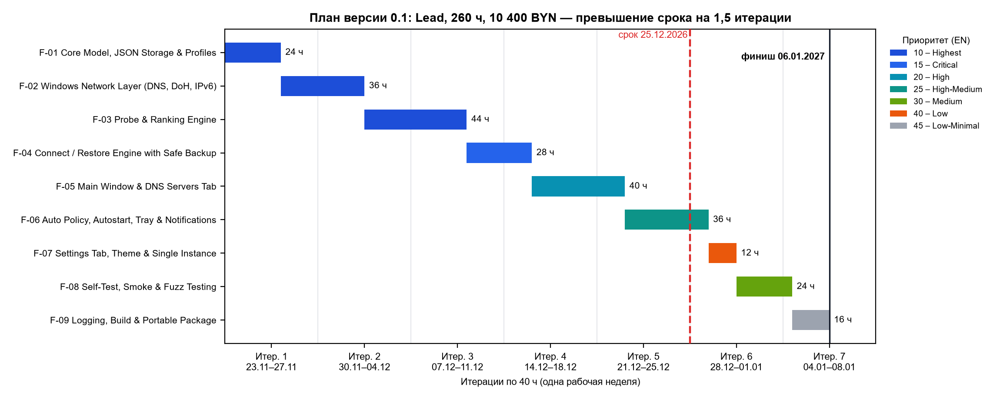

# Переписка с Заказчиком и планы реализации Murik DNS

Версия 0.1, 16.11.2026.

**Сообщение 1.** Исполнитель (В. К. Мурачев) → Заказчик (Д. Д. Левшук), 16.11.2026, 18:40

> Добрый вечер, Дмитрий! По согласованной SRS версии 0.2 подготовлены описание проектирования (SDD версии 0.1) и протоколы решений ADR-0001…0003. Работа разбита на девять блоков F-01…F-09 с приоритетами от 10 до 45. При ставке 40 BYN/ч и итерации 40 ч объём составляет 260 ч (10 400 BYN), то есть 6,5 итерации с финишем 06.01.2027. До срока 25.12.2026 помещается 200 ч. Посмотрите, пожалуйста, сроки и приоритеты по блокам.

## План версии 0.1

| Блок | Priority | Трудоёмкость, ч | Стоимость, BYN | Итерации |
|------|----------|-----------------|----------------|----------|
| F-01 Core Model, JSON Storage & Profiles | 10 – Highest (Foundation) | 24 | 960 | 1 |
| F-02 Windows Network Layer (DNS, DoH, IPv6) | 10 – Highest (Foundation) | 36 | 1 440 | 1–2 |
| F-03 Probe & Ranking Engine | 10 – Highest (Core Value) | 44 | 1 760 | 2–3 |
| F-04 Connect / Restore Engine with Safe Backup | 15 – Critical (Safety) | 28 | 1 120 | 3–4 |
| F-05 Main Window & DNS Servers Tab | 20 – High (Workspace) | 40 | 1 600 | 4–5 |
| F-06 Auto Policy, Autostart, Tray & Notifications | 25 – High-Medium (Background) | 36 | 1 440 | 5–6 |
| F-07 Settings Tab, Theme & Single Instance | 40 – Low (Comfort) | 12 | 480 | 6 |
| F-08 Self-Test, Smoke & Fuzz Testing | 30 – Medium (Quality) | 24 | 960 | 6–7 |
| F-09 Logging, Build & Portable Package | 45 – Low-Minimal (Delivery) | 16 | 640 | 7 |
| Итого (версия 0.1) | 10..45 | 260 | 10 400 | 6,5 итерации, финиш 06.01.2027 |

