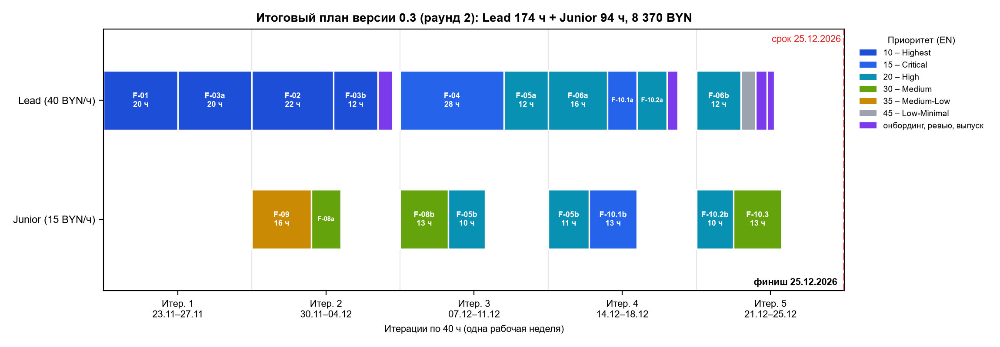
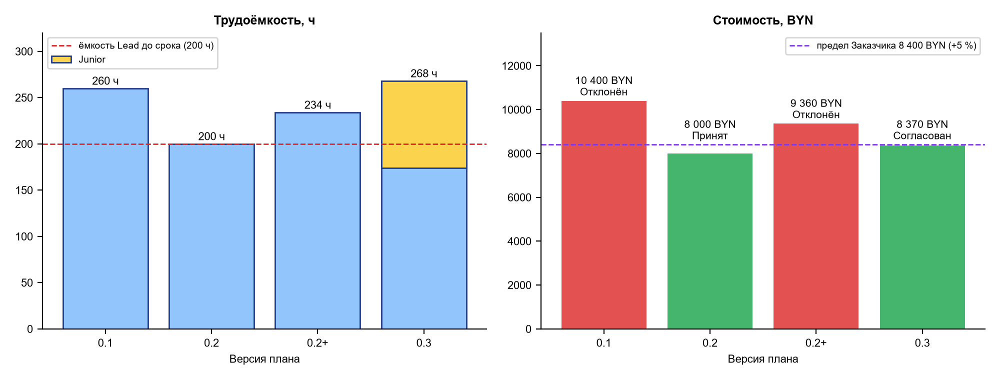

# Переписка с Заказчиком и планы реализации Murik DNS

Версия 0.3, 18.11.2026. Исполнитель — Мурачев В. К., Заказчик — Д. Д. Левшук.

Параметры планирования: итерация — одна рабочая неделя (40 ч одного разработчика), старт 23.11.2026, срок выпуска 25.12.2026 (пять итераций, 200 ч), ставка Lead 40 BYN/ч, Junior 15 BYN/ч. Приоритеты — от 10 (наивысший) до 50 (минимальный) на английском языке.

## Раунд 1 (16.11.2026 – 17.11.2026)

**Сообщение 1.** Исполнитель (В. К. Мурачев) → Заказчик (Д. Д. Левшук), 16.11.2026, 18:40

> Добрый вечер, Дмитрий! По согласованной SRS версии 0.2 подготовлены описание проектирования (SDD версии 0.1) и протоколы решений ADR-0001…0003. Работа разбита на девять блоков F-01…F-09 с приоритетами от 10 до 45. При ставке 40 BYN/ч и итерации 40 ч объём составляет 260 ч (10 400 BYN), то есть 6,5 итерации с финишем 06.01.2027. До срока 25.12.2026 помещается 200 ч. Посмотрите, пожалуйста, сроки и приоритеты по блокам.

**Сообщение 2.** Заказчик (Д. Д. Левшук) → Исполнитель (В. К. Мурачев), 17.11.2026, 09:15

> Владислав, посмотрел таблицу. Не ожидал, что подбор DNS (F-03) займёт 44 ч, окно с таблицей серверов (F-05) — 40 ч, а трей с автозапуском (F-06) — 36 ч. Программа нужна к 25.12.2026, позже не подходит, и больше 8 000 BYN я не готов. Приоритеты меняю: работа в трее и автозапуск (F-06) для меня важнее — с 25 на 20, сборка архива для друга (F-09) — с 45 на 35, а тему оформления (F-07) можно опустить до 45. Объясните, почему так долго, и что можно сократить.

**Сообщение 3.** Исполнитель (В. К. Мурачев) → Заказчик (Д. Д. Левшук), 17.11.2026, 13:30

> Дмитрий, поясняю. F-03 — это DNS-запросы по UDP и DoH, HTTPS-проверка ChatGPT и Claude именно через проверяемый DNS, ping, параллельный запуск 15 проверок с отменой за 1,5 с и устойчивость к 20 000 повреждённых пакетов. Один HTTPS-клиент с закреплённым IP для DoH и проверки сервисов (ADR-0003) сокращает F-03 на 12 ч, а сам блок делится на ранжирование F-03a (20 ч) и HTTPS-проверки F-03b (12 ч). F-05 — два экрана по мокапам UI-01 и UI-02; стандартные виджеты Qt со стилями QSS и таблица model/view вместо ручной отрисовки (ADR-0004) экономят 12 ч. В F-06 повтор подключения и переход на новую сеть объединяются в один автомат Policy — минус 8 ч. Ещё 28 ч дают единый формат JSON с версией на C# (F-01, 4 ч), netsh для DoH и IPv6 вместо части WMI (F-02, 8 ч), тема как вторая палитра QSS (F-07, 4 ч), самотестирование внутри EXE вместо отдельного проекта тестов (F-08, 8 ч) и готовый скрипт windeployqt (F-09, 4 ч). Итого 200 ч, 8 000 BYN, финиш 25.12.2026.

**Сообщение 4.** Заказчик (Д. Д. Левшук) → Исполнитель (В. К. Мурачев), 17.11.2026, 16:05

> Теперь понятно, за что платить. Все функции из SRS остаются, срок и бюджет устраивают. План версии 0.2 на 200 ч и 8 000 BYN принимаю.

## Раунд 2 (18.11.2026)

**Сообщение 5.** Заказчик (Д. Д. Левшук) → Исполнитель (В. К. Мурачев), 18.11.2026, 10:20

> Владислав, показал мокапы друзьям, и у нас два изменения. Первое: тёмная тема не нужна, а Windows 10 у друга уже обновили до 11, поэтому режим без DoH тоже убираем. Второе: я забыл про важное. Адреса провайдеров меняются, и ждать новую сборку неудобно — нужно добавлять и править свои DNS прямо в программе и передавать список другу файлом. И хочу сам выбирать, какие сервисы проверять: кроме ChatGPT и Claude ещё Gemini. Это то, что в SRS было отложено как DEF-1 и DEF-2. Оцените, пожалуйста.

**Сообщение 6.** Исполнитель (В. К. Мурачев) → Заказчик (Д. Д. Левшук), 18.11.2026, 13:00

> Дмитрий, отмена темы освобождает 4 ч в F-07, отказ от Windows 10 — 6 ч в F-02, всего 10 ч. Новый блок F-10 для одного Lead — 44 ч: F-10.1 редактор своих профилей с проверкой адресов и пробным подключением (18 ч, приоритет 15 – Critical), F-10.2 настраиваемый список сервисов и обобщённая оценка (16 ч, 20 – High), F-10.3 импорт и экспорт файла профилей с тестами (10 ч, 30 – Medium). Объём становится 234 ч (9 360 BYN, +17 %), и один разработчик закончит только 31.12.2026. Предлагаю перенести срок на эту дату.

**Сообщение 7.** Заказчик (Д. Д. Левшук) → Исполнитель (В. К. Мурачев), 18.11.2026, 15:10

> Приоритеты F-10 подтверждаю, без него программа быстро устареет. Но 25.12.2026 не двигаем, и 9 360 BYN — слишком дорого. Могу добавить не больше 4–5 %. Предложите решение без переноса срока.

**Сообщение 8.** Исполнитель (В. К. Мурачев) → Заказчик (Д. Д. Левшук), 18.11.2026, 17:30

> Предлагаю со второй итерации (30.11.2026) подключить Junior-разработчика со ставкой 15 BYN/ч. Ядро отделено от интерфейса (ADR-0001, ADR-0004), поэтому ему можно передать вкладку «DNS-серверы» (F-05b), тесты (F-08), сборку архива (F-09), интерфейс редактора и списка сервисов (F-10.1b, F-10.2b) и импорт/экспорт (F-10.3): 94 ч с учётом коэффициента скорости 1,3, это 1 410 BYN. За мной остаются ядро подбора и подключения, сетевой слой, автомат Policy и проверка профилей, а также онбординг (4 ч), код-ревью (6 ч) и выпуск (2 ч): 174 ч, 6 960 BYN. Итого 8 370 BYN (+370 BYN, или 4,6 %), финиш 25.12.2026. Неиспользованные 26 ч Lead в пятой итерации — резерв на регрессионное тестирование, в стоимость не входят.

**Сообщение 9.** Заказчик (Д. Д. Левшук) → Исполнитель (В. К. Мурачев), 18.11.2026, 19:45

> Рост на 4,6 % устраивает, весь F-10 попадает в выпуск, а подключение DNS остаётся за вами. План версии 0.3 на 8 370 BYN со сдачей 25.12.2026 утверждаю.

## План версии 0.1 (отклонён)

| Блок | Priority | Трудоёмкость, ч | Стоимость, BYN | Итерации |
|------|----------|-----------------|----------------|----------|
| F-01 Core Model, JSON Storage & Profiles | 10 – Highest (Foundation) | 24 | 960 | 1 |
| F-02 Windows Network Layer (DNS, DoH, IPv6) | 10 – Highest (Foundation) | 36 | 1 440 | 1–2 |
| F-03 Probe & Ranking Engine | 10 – Highest (Core Value) | 44 | 1 760 | 2–3 |
| F-04 Connect / Restore Engine with Safe Backup | 15 – Critical (Safety) | 28 | 1 120 | 3–4 |
| F-05 Main Window & DNS Servers Tab | 20 – High (Workspace) | 40 | 1 600 | 4–5 |
| F-06 Auto Policy, Autostart, Tray & Notifications | 25 – High-Medium (Background) | 36 | 1 440 | 5–6 |
| F-07 Settings Tab, Theme & Single Instance | 40 – Low (Comfort) | 12 | 480 | 6 |
| F-08 Self-Test, Smoke & Fuzz Testing | 30 – Medium (Quality) | 24 | 960 | 6–7 |
| F-09 Logging, Build & Portable Package | 45 – Low-Minimal (Delivery) | 16 | 640 | 7 |
| Итого (версия 0.1) | 10..45 | 260 | 10 400 | 6,5 итерации, финиш 06.01.2027 |

## План версии 0.2 (раунд 1)

| Итерация | Задачи | Priority | Зависимости | Часы | Стоимость, BYN |
|----------|--------|----------|-------------|------|----------------|
| 1 (23.11–27.11) | F-01 Модель и хранилище JSON (20 ч) + F-03a DNS-пакеты и ранжирование (20 ч) | 10 | – | 40 | 1 600 |
| 2 (30.11–04.12) | F-02 Сетевой слой Windows (28 ч) + F-03b Проверки HTTPS и DoH (12 ч) | 10 | После F-01 | 40 | 1 600 |
| 3 (07.12–11.12) | F-04 Подключение и откат (28 ч) + F-05a Главное окно UI-01 (12 ч) | 15, 20 | После F-02, F-03 | 40 | 1 600 |
| 4 (14.12–18.12) | F-05b Вкладка «DNS-серверы» UI-02 (16 ч) + F-06a Автомат Policy и трей (16 ч) + F-07 Настройки, один экземпляр (8 ч) | 20, 45 | После F-04, F-05a | 40 | 1 600 |
| 5 (21.12–25.12) | F-06b Автозапуск, уведомления (12 ч) + F-08 Самотестирование, fuzz (16 ч) + F-09 Журнал, сборка, ZIP (12 ч) | 20, 30, 35 | После F-06a | 40 | 1 600 |
| Итого (версия 0.2) | 9 блоков | 10..45 | – | 200 | 8 000 |

## Изменения раунда 2

Отменено: F-07 — тема оформления (REQ-FUNC-013) (−4 ч); F-02 — режим Windows 10 без DoH (REQ-PORT-001-2) (−6 ч).

| Задача | Название | Priority | Часы Lead | Состав |
|--------|----------|----------|-----------|--------|
| F-10.1 | Own DNS Profiles Editor | 15 – Critical (User Profiles) | 18 | 8 ядро проверки + 10 диалог |
| F-10.2 | Configurable Checked Services | 20 – High (Service Coverage) | 16 | 8 ядро оценки + 8 интерфейс |
| F-10.3 | Profiles Import / Export & Tests | 30 – Medium (Sharing) | 10 | 10 |

## План версии 0.3 (согласован)

| Итерация | Исполнитель | Задачи | Часы | Стоимость, BYN |
|----------|-------------|--------|------|----------------|
| 1 (23.11–27.11) | Lead (40 BYN/ч) | F-01 Модель и хранилище (20 ч) + F-03a Ранжирование (20 ч) | 40 | 1 600 |
| 2 (30.11–04.12) | Lead (40 BYN/ч) | F-02 Сетевой слой (22 ч) + F-03b HTTPS и DoH (12 ч) + Онбординг (4 ч) | 38 | 1 520 |
| 2 (30.11–04.12) | Junior (15 BYN/ч) | F-09 Журнал, сборка, ZIP (16 ч) + F-08a Каркас self-test (8 ч) | 24 | 360 |
| 3 (07.12–11.12) | Lead (40 BYN/ч) | F-04 Подключение и откат (28 ч) + F-05a Главное окно (12 ч) | 40 | 1 600 |
| 3 (07.12–11.12) | Junior (15 BYN/ч) | F-08b Тесты, fuzz (13 ч) + F-05b Модель таблицы (10 ч) | 23 | 345 |
| 4 (14.12–18.12) | Lead (40 BYN/ч) | F-06a Policy и трей (16 ч) + F-10.1a Проверка профиля (8 ч) + F-10.2a Оценка по сервисам (8 ч) + Код-ревью (3 ч) | 35 | 1 400 |
| 4 (14.12–18.12) | Junior (15 BYN/ч) | F-05b Вкладка «DNS-серверы» (11 ч) + F-10.1b Диалог профиля (13 ч) | 24 | 360 |
| 5 (21.12–25.12) | Lead (40 BYN/ч) | F-06b Автозапуск, уведомления (12 ч) + F-07 Один экземпляр (4 ч) + Код-ревью (3 ч) + Выпуск (2 ч) | 21 | 840 |
| 5 (21.12–25.12) | Junior (15 BYN/ч) | F-10.2b Список сервисов (10 ч) + F-10.3 Импорт/экспорт, тесты (13 ч) | 23 | 345 |
| Итого (версия 0.3) | Lead + Junior | 10 блоков F-01…F-10, финиш 25.12.2026 | 174 + 94 | 8 370 |

## Сравнение версий плана

| Версия | Команда | Трудоёмкость | Стоимость, BYN | Финиш | Результат |
|--------|---------|--------------|----------------|-------|-----------|
| 0.1 | Lead | 260 ч | 10 400 | 06.01.2027 | Отклонён: срыв срока на 1,5 итерации |
| 0.2 | Lead | 200 ч | 8 000 | 25.12.2026 | Принят в раунде 1 |
| 0.2+ | Lead | 234 ч | 9 360 | 31.12.2026 | Отклонён: сдвиг срока и рост цены на 17 % |
| 0.3 | Lead + Junior | 174 + 94 ч | 8 370 | 25.12.2026 | Согласован: рост цены на 4,6 % |

