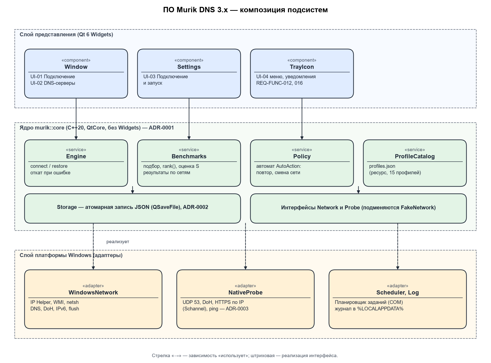
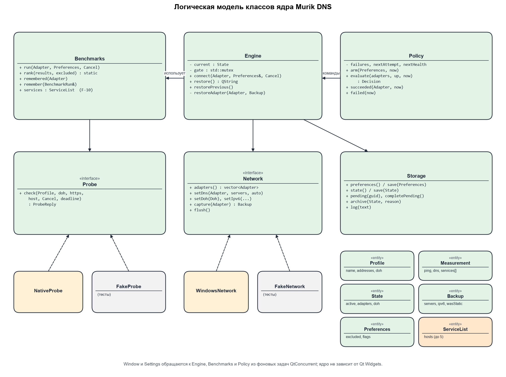
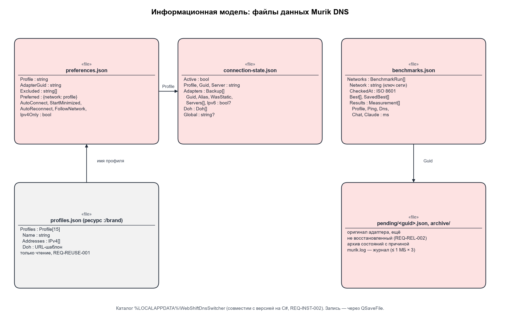
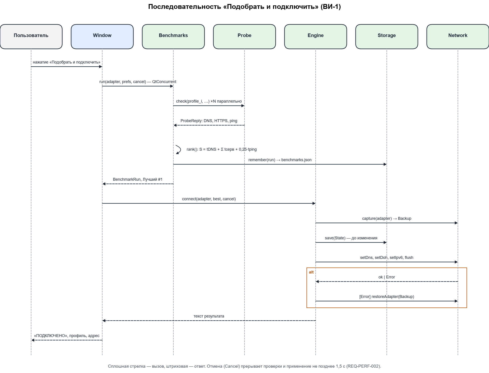
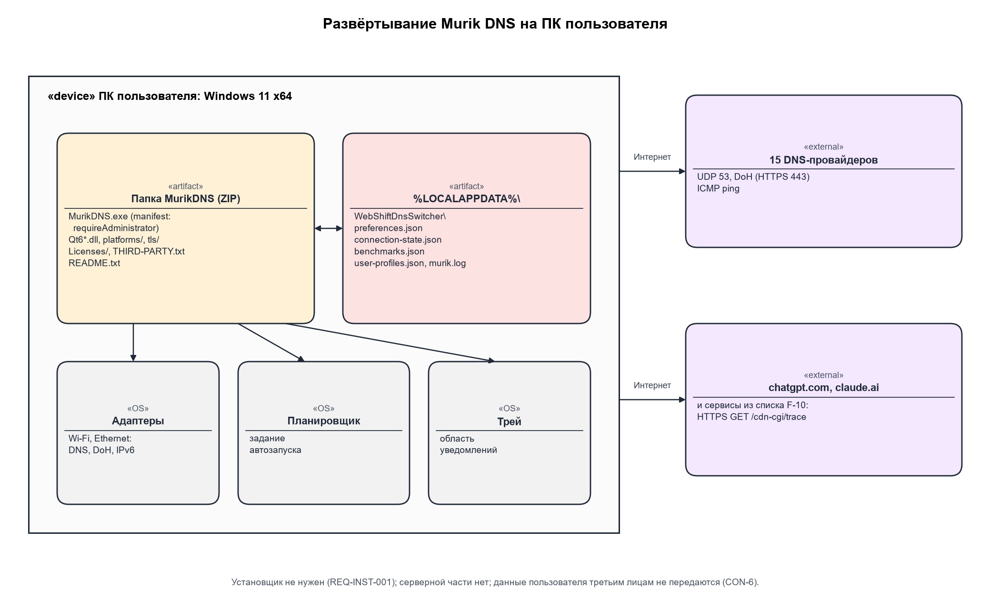
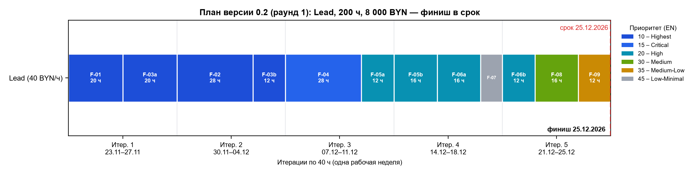

# Описание дизайна программного обеспечения

Для **Murik DNS 3.1** — настольного приложения для подбора и подключения DNS-серверов, обеспечивающих доступ к ChatGPT, Claude

Версия 0.2

Подготовил Мурачев В. К., гр. 434701

БГУИР, военный факультет, кафедра ЭВМ

17.11.2026

## Оглавление

<!-- TOC -->
* [1. Введение](#1-introduction)
  * [1.1 Назначение документа](#11-document-purpose)
  * [1.2 Область применения](#12-subject-scope)
  * [1.3 Определения, акронимы и сокращения](#13-definitions-acronyms-and-abbreviations)
  * [1.4 Ссылки](#14-references)
  * [1.5 Обзор документа](#15-document-overview)
* [2. Обзор дизайна](#2-design-overview)
  * [2.1 Задачи стейкхолдеров](#21-stakeholder-concerns)
  * [2.2 Выбранные точки зрения](#22-selected-viewpoints)
    * [2.2.1 Контекст](#221-context)
    * [2.2.2 Композиция](#222-composition)
    * [2.2.3 Логическое представление](#223-logical)
    * [2.2.4 Физическое представление](#224-physical)
    * [2.2.5 Структура](#225-structure)
    * [2.2.6 Зависимости](#226-dependency)
    * [2.2.7 Информация](#227-information)
    * [2.2.8 Интерфейс](#228-interface)
    * [2.2.9 Взаимодействие](#229-interaction)
    * [2.2.10 Алгоритм](#2210-algorithm)
    * [2.2.11 Динамика состояний](#2211-state-dynamics)
    * [2.2.12 Параллелизм](#2212-concurrency)
    * [2.2.13 Паттерны](#2213-patterns)
    * [2.2.14 Развёртывание](#2214-deployment)
    * [2.2.15 Ресурсы](#2215-resources)
* [3. Проектные представления](#3-design-views)
* [4. Решения](#4-decisions)
* [5. Приложения](#5-appendixes)
<!-- TOC -->

## История изменений

| Name | Date | Reason For Changes | Version |
|------|------|--------------------|---------|
| Мурачев В. К. | 16.11.2026 | Первая редакция: точки зрения, представления VIEW-01…09, системные требования, ADR-0001…0003, план 0.1 | 0.1 |
| Мурачев В. К. | 17.11.2026 | Раунд 1: приоритеты Заказчика (F-06, F-07, F-09), ADR-0004, план 0.2 на 200 ч | 0.2 |

---

## 1. Введение {#1-introduction}

### 1.1 Назначение документа {#11-document-purpose}

Документ описывает, **как** устроено ПО Murik DNS, реализующее требования [SRS](../srs/srs-murikdns.md): подсистемы, классы, данные, взаимодействия, развёртывание и принятые решения. Читатели: разработчики (Lead и будущие участники) — реализуют по представлениям раздела 3; Заказчик — проверяет трассировку требований и план; сопровождающий — находит, где менять код при обновлении профилей.

### 1.2 Область применения {#12-subject-scope}

Проектируется выпуск Murik DNS 3.1 для Windows 11 x64 (в Windows 10 — без DoH): подбор DNS по задержкам, подключение с сохранением оригинала, откат, работа в трее, автозапуск и восстановление после смены сети. VPN, прокси и серверная часть не входят (CON-4).

### 1.3 Определения, акронимы и сокращения {#13-definitions-acronyms-and-abbreviations}

| Term | Definition |
|------|------------|
| ADR | Architecture Decision Record — протокол архитектурного решения (MADR) |
| Backup | Сохранённый оригинал адаптера: DNS, DoH, IPv6 |
| DoH | DNS over HTTPS, RFC 8484 |
| Lead / Junior | Ведущий и младший разработчики в плане реализации |
| Priority | Приоритет на английском языке: 10 – Highest … 50 – Minimal |
| SDD | Software Design Description, IEEE 1016-2009 |
| SYS-* | Системное требование: обязательство подсистемы, трассируемое к REQ-* из SRS |

### 1.4 Ссылки {#14-references}

| Документ | Тип |
|----------|-----|
| IEEE 1016-2009. Software Design Descriptions | Нормативная |
| ISO/IEC/IEEE 42010:2011. Architecture description | Нормативная |
| ISO/IEC 25010:2011. Quality models | Справочная |
| MADR 4.0, https://adr.github.io/madr/ | Нормативная |
| SRS Murik DNS: [srs-murikdns.md](../srs/srs-murikdns.md), версия 0.2 | Нормативная |
| Переписка и планы: [correspondence-and-plans.md](correspondence-and-plans.md) | Справочная |

### 1.5 Обзор документа {#15-document-overview}

Раздел 2 — стейкхолдеры и выбранные точки зрения. Раздел 3 — девять представлений VIEW-01…VIEW-09 и системные требования с приоритетами. Раздел 4 — решения ADR. Раздел 5 — план реализации. Каждое изменение повышает версию и записывается в историю.

---

## 2. Обзор дизайна {#2-design-overview}

### 2.1 Задачи стейкхолдеров {#21-stakeholder-concerns}

| Стейкхолдер | Задачи | Представления |
|-------------|--------|---------------|
| Заказчик (Д. Д. Левшук) | доступ в одно нажатие, безопасный откат, срок и цена | VIEW-01, VIEW-05, раздел 5 |
| Обычный пользователь | понятное состояние, работа в трее | VIEW-01, VIEW-07 |
| Опытный пользователь | таблица серверов, ручной выбор | VIEW-04, VIEW-06 |
| Разработчики | модули, интерфейсы, потоки, тесты без изменения сети | VIEW-02, VIEW-03, VIEW-08 |
| Сопровождающий | файлы данных, сборка, журнал | VIEW-04, VIEW-09 |

### 2.2 Выбранные точки зрения {#22-selected-viewpoints}

Из 15 точек зрения шаблона для однопользовательского настольного приложения без серверной части выбраны девять (VIEW-01…VIEW-09 в разделе 3); для остальных указана причина, по которой отдельное представление не требуется.

#### 2.2.1 Контекст {#221-context}

**Адресует**: границы системы, акторы, варианты использования ВИ-1…ВИ-6. **Язык**: SysML v2 (контекст и варианты использования из SRS). **Применение**: VIEW-01.

#### 2.2.2 Композиция {#222-composition}

**Адресует**: разбиение на слои и компоненты, размещение функций, интеграция Qt и WinAPI. **Язык**: диаграмма компонентов UML. **Применение**: VIEW-02.

#### 2.2.3 Логическое представление {#223-logical}

**Адресует**: классы ядра, интерфейсы Network и Probe, сущности. **Язык**: диаграмма классов UML. **Применение**: VIEW-03.

#### 2.2.4 Физическое представление {#224-physical}

**Не используется**: специального оборудования нет, ПО работает на одном ПК с любым сетевым адаптером (раздел 3.1.2 SRS).

#### 2.2.5 Структура {#225-structure}

**Не используется**: внутренняя структура компонентов полностью видна в VIEW-02 и VIEW-03, составных частей с портами нет.

#### 2.2.6 Зависимости {#226-dependency}

**Не используется отдельно**: направленные зависимости «использует» показаны стрелками VIEW-02 и VIEW-03; правило — слой представления → ядро → адаптеры (ADR-0001).

#### 2.2.7 Информация {#227-information}

**Адресует**: состав и схема файлов данных, совместимость с версией на C#, целостность. **Язык**: логическая модель данных. **Применение**: VIEW-04.

#### 2.2.8 Интерфейс {#228-interface}

**Не используется отдельно**: внешних API нет; контракты интерфейсов Network и Probe (сигнатуры методов) приведены в VIEW-03, протоколы — в REQ-INT-004.

#### 2.2.9 Взаимодействие {#229-interaction}

**Адресует**: порядок вызовов, обработку ошибки и откат в сценарии ВИ-1. **Язык**: диаграмма последовательности UML. **Применение**: VIEW-05.

#### 2.2.10 Алгоритм {#2210-algorithm}

**Адресует**: критерий доступности и формулу оценки профиля, сложность сортировки. **Язык**: математическая формулировка. **Применение**: VIEW-06.

#### 2.2.11 Динамика состояний {#2211-state-dynamics}

**Адресует**: состояния подключения и автомат Policy, интервалы повторов. **Язык**: диаграмма состояний SysML v2 из SRS, таблица действий. **Применение**: VIEW-07.

#### 2.2.12 Параллелизм {#2212-concurrency}

**Адресует**: фоновые задачи, параллельные проверки, мьютекс Engine, отмену. **Язык**: описание на естественном языке. **Применение**: VIEW-08.

#### 2.2.13 Паттерны {#2213-patterns}

**Не используется отдельно**: применённые паттерны зафиксированы в решениях — «адаптер» и подмена зависимостей (ADR-0001), атомарная запись (ADR-0002), model/view (ADR-0004).

#### 2.2.14 Развёртывание {#2214-deployment}

**Адресует**: состав переносимой папки, каталог данных, связи с Интернетом. **Язык**: диаграмма развёртывания UML. **Применение**: VIEW-09.

#### 2.2.15 Ресурсы {#2215-resources}

**Не используется отдельно**: ограничения времени, потоков и памяти заданы системными требованиями SYS-PERF-001…003; сетевые ресурсы ограничены CON-5.

---

## 3. Проектные представления {#3-design-views}

- **ID:** VIEW-01-context
- **Title:** Системный контекст
- **Viewpoint:** Context
- **Representation:** приложение взаимодействует с пользователем, сетевыми настройками Windows, Планировщиком заданий, треем, 15 DNS-провайдерами и проверяемыми сервисами; рисунок 2 SRS ([01-context.png](../srs/images/01-context.png)).
- **More Information:** REQ-INT-004, CON-1…CON-6.

- **ID:** VIEW-02-composition
- **Title:** Композиция подсистем
- **Viewpoint:** Composition
- **Representation:** три слоя с однонаправленными зависимостями: представление (Window, Settings, TrayIcon), ядро murik::core (Engine, Benchmarks, Policy, Storage), адаптеры Windows (WindowsNetwork, NativeProbe, Scheduler).

- **More Information:** ADR-0001.

- **ID:** VIEW-03-logical
- **Title:** Логическая модель классов
- **Viewpoint:** Logical
- **Representation:** Engine использует интерфейсы Network и Probe и класс Storage; Benchmarks — Probe; Policy выдаёт решения Decision для Window. Реализации WindowsNetwork и NativeProbe подменяются FakeNetwork и FakeProbe в тестах.

- **More Information:** REQ-MAINT-001, ADR-0001.

- **ID:** VIEW-04-information
- **Title:** Информационная модель
- **Viewpoint:** Information
- **Representation:** файлы preferences.json, connection-state.json, benchmarks.json, pending/, archive/, murik.log в %LOCALAPPDATA%\WebShiftDnsSwitcher и ресурс profiles.json.

- **More Information:** REQ-INT-005, REQ-INST-002, ADR-0002.

- **ID:** VIEW-05-interaction
- **Title:** Сценарий «Подобрать и подключить»
- **Viewpoint:** Interaction
- **Representation:** Window запускает Benchmarks::run в фоне, Probe проверяет профили параллельно, rank выбирает лучший, Engine сохраняет оригинал, применяет профиль и при ошибке откатывает.

- **More Information:** ВИ-1, REQ-FUNC-001…005, REQ-REL-001.

- **ID:** VIEW-06-algorithm
- **Title:** Оценка и ранжирование профилей
- **Viewpoint:** Algorithm
- **Representation:** профиль доступен, если DNS-ответ получен и все проверяемые сервисы ответили по HTTPS. Оценка S = t_DNS + t_ChatGPT + t_Claude + 0,25 · t_ping (мс; без ответа на ping t_ping = 0). Сортировка по S, затем по названию; первые три — «Лучший #1–3». Сложность O(n log n), n ≤ 15.
- **More Information:** REQ-FUNC-002-2.

- **ID:** VIEW-07-state
- **Title:** Состояния подключения и автомат Policy
- **Viewpoint:** State Dynamics
- **Representation:** состояния Отключено → Подбор → Применение → Подключено → Ожидание сети → Применение; ошибка применения → Восстановление → Отключено (рисунок 4 SRS). Policy вычисляет действие None, WaitingNetwork, WaitingStable, Connect или Health по таймеру 1 с; интервалы повтора 5, 10, 20, 40, 60 с.
- **More Information:** REQ-FUNC-009, REQ-FUNC-010.

- **ID:** VIEW-08-concurrency
- **Title:** Потоки и синхронизация
- **Viewpoint:** Concurrency
- **Representation:** поток интерфейса Qt; задачи подбора и подключения — QtConcurrent::run с QFutureWatcher; проверки профилей — параллельно в пуле; Engine защищён std::mutex, одновременно выполняется одна операция изменения сети; отмена — общий std::atomic_bool (Cancel).
- **More Information:** REQ-PERF-002, REQ-PERF-003.

- **ID:** VIEW-09-deployment
- **Title:** Развёртывание
- **Viewpoint:** Deployment
- **Representation:** переносимая папка MurikDNS с Qt DLL на ПК пользователя, данные в %LOCALAPPDATA%, связь с провайдерами и сервисами через Интернет.

- **More Information:** REQ-INST-001, REQ-COMP-001.

### 3.10 Системные функциональные требования

| ID | Подсистема | Системное требование | Трассировка к SRS | Priority |
|----|-----------|----------------------|-------------------|----------|
| SYS-FUNC-001 | Probe / Benchmarks | Сервис Benchmarks параллельно (QtConcurrent) проверяет все неисключённые профили на активном адаптере: DNS-запрос по UDP 53 или DoH, HTTPS GET `/cdn-cgi/trace` к проверяемым сервисам по закреплённому IP, ping; проверка одного профиля ограничена 8 с | REQ-FUNC-001, REQ-INT-004, REQ-PERF-001 | 10 – Highest (Core Value) |
| SYS-FUNC-002 | Probe / Benchmarks | Функция Benchmarks::rank отсеивает недоступные профили и упорядочивает доступные по оценке S = t_DNS + t_ChatGPT + t_Claude + 0,25 · t_ping (при равенстве — по названию), отмечая «Лучший #1–3» | REQ-FUNC-002-2 | 10 – Highest (Core Value) |
| SYS-FUNC-003 | Engine | Engine::connect под мьютексом сохраняет оригинал адаптера (Backup) в connection-state.json до изменения, записывает IPv4-адреса, шаблон DoH и состояние IPv6, сбрасывает кэш DNS и проверяет результат; при ошибке вызывает restoreAdapter | REQ-FUNC-003, REQ-FUNC-004-2, REQ-FUNC-014, REQ-REL-001 | 15 – Critical (Safety) |
| SYS-FUNC-004 | Engine / Storage | Engine::restore отменяет ожидающую операцию и восстанавливает DNS, DoH и IPv6 из сохранённого оригинала; оригинал отсутствующего адаптера хранится в pending/<guid>.json до его появления | REQ-FUNC-005-2, REQ-REL-002 | 15 – Critical (Safety) |
| SYS-FUNC-005 | Policy | Конечный автомат Policy (None, WaitingNetwork, WaitingStable, Connect, Health) повторяет подключение через 5, 10, 20, 40 и далее 60 с, проверяет подключение каждые 60 с и после смены адаптера ждёт стабильной сети не менее 3 с | REQ-FUNC-009, REQ-FUNC-010 | 20 – High (Background) |
| SYS-FUNC-006 | Platform | Задание автозапуска регистрируется через COM-интерфейс Планировщика заданий Windows с наивысшими правами; при запуске из задания окно не открывается, сохранённый профиль подключается без подбора | REQ-FUNC-011 | 20 – High (Background) |
| SYS-FUNC-007 | Benchmarks / Storage | Результаты подбора сохраняются в benchmarks.json по ключу сети Adapter::networkKey() и показываются при возврате в эту сеть | REQ-FUNC-008 | 25 – High-Medium (Workspace) |
| SYS-FUNC-008 | Core | Каталог профилей загружает 15 профилей из ресурса profiles.json; профиль с некорректным IPv4-адресом или URL DoH отвергается при загрузке | REQ-INT-005, REQ-REUSE-001 | 10 – Highest (Foundation) |
| SYS-UI-001 | UI | Окно Window (1140×820, минимум 1040×700) реализует UI-01 и UI-02: состояние, профиль, адрес и режим; таблица QTableView с делегатом отметки «Исключить», панель «Вручную» | REQ-INT-001…003, REQ-FUNC-006, REQ-FUNC-007 | 20 – High (Workspace) |
| SYS-UI-002 | UI | Значок QSystemTrayIcon с меню «Открыть», «Отключить DNS», «Выход»; закрытие окна скрывает его в трей; уведомление при автоматических действиях | REQ-FUNC-012, REQ-FUNC-016 | 20 – High (Background) |
| SYS-UI-003 | UI / Platform | Вкладка UI-03 с переключателем темы (QSS-палитра) и блокировка единственного экземпляра через QLocalServer | REQ-FUNC-013, REQ-FUNC-015 | 45 – Low-Minimal (Comfort) |

### 3.11 Системные нефункциональные требования

| ID | Подсистема | Системное требование | Трассировка к SRS | Priority |
|----|-----------|----------------------|-------------------|----------|
| SYS-PERF-001 | Performance | Полный подбор 15 профилей — не более 10 с при двух сервисах | REQ-PERF-001 | 10 – Highest (Core Value) |
| SYS-PERF-002 | Performance | Токен Cancel проверяется между шагами, сокеты прерываются; отмена возвращает управление не более чем за 1,5 с | REQ-PERF-002 | 15 – Critical (Safety) |
| SYS-PERF-003 | Performance | Сетевые операции выполняются в пуле QtConcurrent, поток интерфейса блокируется не более чем на 100 мс | REQ-PERF-003 | 20 – High (Workspace) |
| SYS-SEC-001 | Security | Манифест requireAdministrator; при отказе в UAC процесс завершается без изменения сети | REQ-SEC-001 | 10 – Highest (Foundation) |
| SYS-SEC-002 | Security | Запросы проверки не содержат cookies, учётных данных и заголовков пользователя; изменяются только DNS, DoH, IPv6 и задание автозапуска | REQ-SEC-002, REQ-SEC-004 | 15 – Critical (Safety) |
| SYS-SEC-003 | Security | Архив выпуска собирается из каталога сборки и не содержит файлов %LOCALAPPDATA% | REQ-SEC-003 | 35 – Medium-Low (Delivery) |
| SYS-REL-001 | Reliability | Все JSON-файлы записываются атомарно (QSaveFile: временный файл и переименование); состояние сохраняется до изменения адаптера | REQ-REL-001, REQ-REL-002 | 10 – Highest (Foundation) |
| SYS-REL-002 | Reliability | Разбор DNS-ответа с проверкой границ и ограничением цепочки указателей сжатия; 20 000 случайных пакетов без сбоя | REQ-REL-003 | 30 – Medium (Quality) |
| SYS-OBS-001 | Maintainability | Журнал murik.log в каталоге данных: дата, время, операция, текст ошибки; ротация при 1 МБ, хранится три файла | REQ-OBS-001 | 35 – Medium-Low (Delivery) |
| SYS-MAINT-001 | Maintainability | Интерфейсы Network и Probe с тестовыми FakeNetwork и FakeProbe; режимы --self-test, --smoke-test, --tray-lifecycle-test | REQ-MAINT-001, REQ-BUILD-002 | 30 – Medium (Quality) |
| SYS-DIST-001 | Portability | Переносимая папка (ZIP) для Windows 11 x64 и Windows 10 x64 без DoH: windeployqt, Licenses/, THIRD-PARTY.txt; сборка Build-Cpp.ps1 без предупреждений; чтение данных версии на C# | REQ-INST-001, REQ-INST-002, REQ-COMP-001, REQ-BUILD-001, REQ-PORT-001-2 | 35 – Medium-Low (Delivery) |

---

## 4. Решения {#4-decisions}

- **ID:** ADR-0001 — [Ядро без Qt Widgets и интерфейсы Network и Probe](../adr/0001-layered-core-with-interfaces.md); принято 16.11.2026.
- **ID:** ADR-0002 — [Хранение в JSON с атомарной записью](../adr/0002-json-storage-atomic-write.md); принято 16.11.2026.
- **ID:** ADR-0003 — [Единый HTTPS-клиент с закреплённым IP для DoH и проверки сервисов](../adr/0003-pinned-https-probe.md); принято 17.11.2026.
- **ID:** ADR-0004 — [Интерфейс на стандартных Qt Widgets, QSS и model/view](../adr/0004-qt-widgets-qss-model-view.md); принято 17.11.2026.

---

## 5. Приложения {#5-appendixes}

### 5.1 План реализации (версия 0.2)

| Итерация | Задачи | Priority | Зависимости | Часы | Стоимость, BYN |
|----------|--------|----------|-------------|------|----------------|
| 1 (23.11–27.11) | F-01 Модель и хранилище JSON (20 ч) + F-03a DNS-пакеты и ранжирование (20 ч) | 10 | – | 40 | 1 600 |
| 2 (30.11–04.12) | F-02 Сетевой слой Windows (28 ч) + F-03b Проверки HTTPS и DoH (12 ч) | 10 | После F-01 | 40 | 1 600 |
| 3 (07.12–11.12) | F-04 Подключение и откат (28 ч) + F-05a Главное окно UI-01 (12 ч) | 15, 20 | После F-02, F-03 | 40 | 1 600 |
| 4 (14.12–18.12) | F-05b Вкладка «DNS-серверы» UI-02 (16 ч) + F-06a Автомат Policy и трей (16 ч) + F-07 Настройки, один экземпляр (8 ч) | 20, 45 | После F-04, F-05a | 40 | 1 600 |
| 5 (21.12–25.12) | F-06b Автозапуск, уведомления (12 ч) + F-08 Самотестирование, fuzz (16 ч) + F-09 Журнал, сборка, ZIP (12 ч) | 20, 30, 35 | После F-06a | 40 | 1 600 |
| Итого (версия 0.2) | 9 блоков | 10..45 | – | 200 | 8 000 |

Переписка с Заказчиком: [correspondence-and-plans.md](correspondence-and-plans.md).
