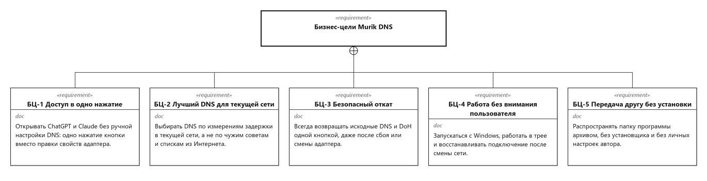
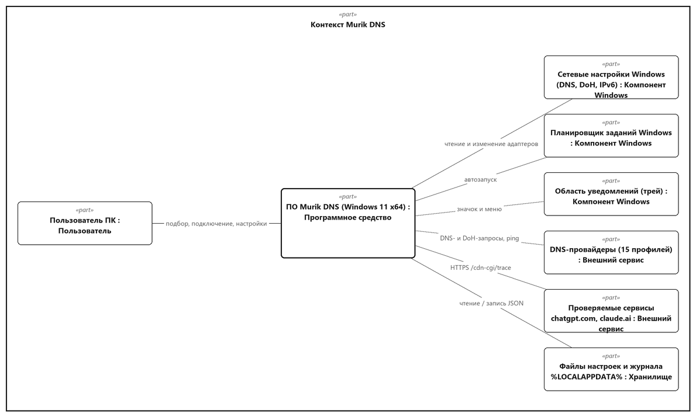
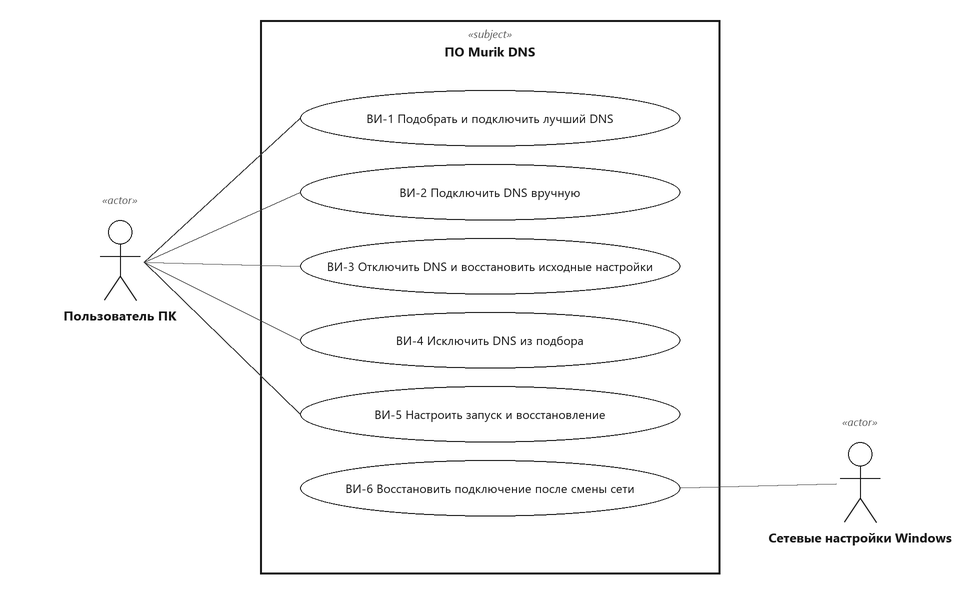
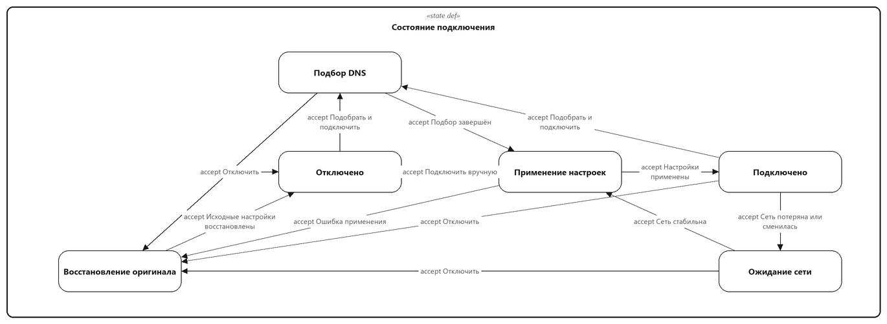
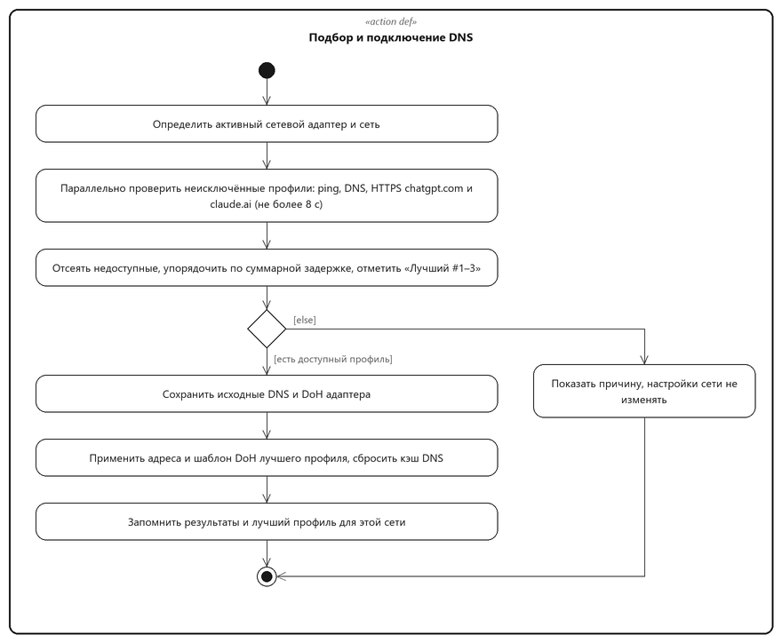
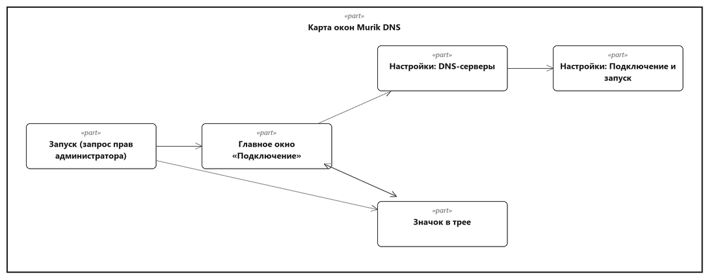
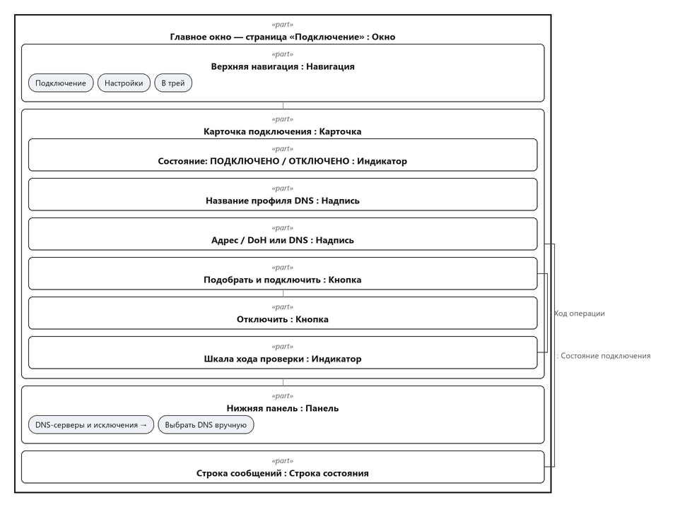
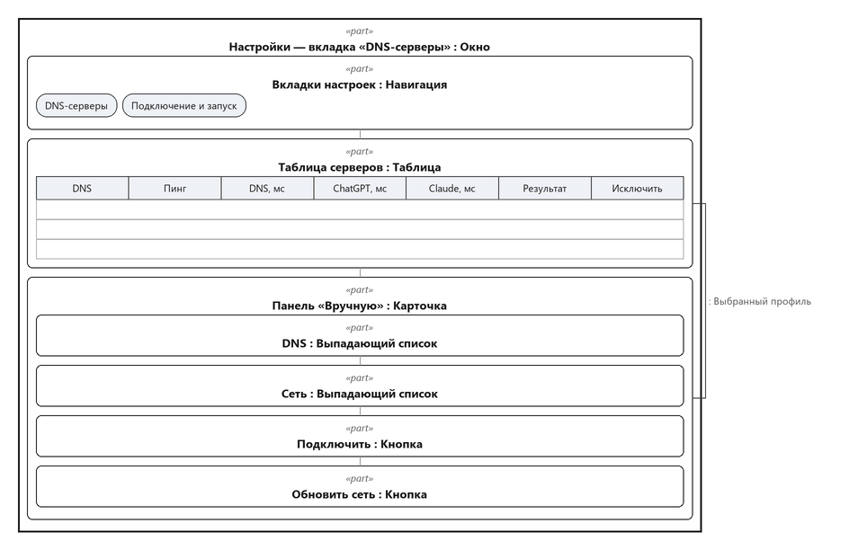
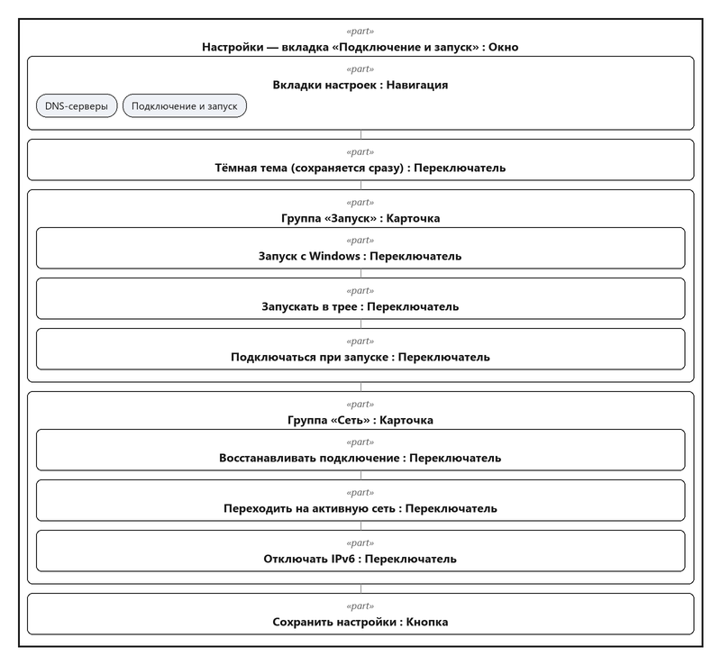
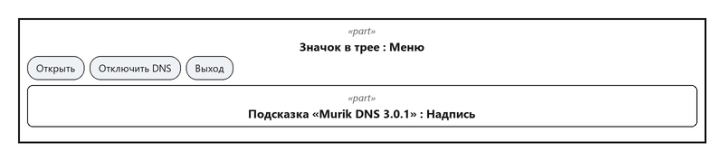

# Спецификация требований к ПО

Для **Murik DNS** — настольного приложения для подбора и подключения DNS-серверов, обеспечивающих доступ к ChatGPT и Claude

Версия 0.1

Подготовил Мурачев В. К., гр. 434701

БГУИР, военный факультет, кафедра ЭВМ

13.11.2026

## Оглавление

<!-- TOC -->
* [1. Введение](#1-introduction)
  * [1.1 Назначение документа](#11-document-purpose)
  * [1.2 Область применения продукта](#12-product-scope)
  * [1.3 Определения, акронимы и сокращения](#13-definitions-acronyms-and-abbreviations)
  * [1.4 Ссылки](#14-references)
  * [1.5 Обзор документа](#15-document-overview)
* [2. Обзор продукта](#2-product-overview)
  * [2.1 Перспектива продукта](#21-product-perspective)
  * [2.2 Функции продукта](#22-product-functions)
  * [2.3 Ограничения продукта](#23-product-constraints)
  * [2.4 Характеристики пользователей](#24-user-characteristics)
  * [2.5 Допущения и зависимости](#25-assumptions-and-dependencies)
  * [2.6 Распределение требований](#26-apportioning-of-requirements)
* [3. Требования](#3-requirements)
  * [3.1 Внешние интерфейсы](#31-external-interfaces)
    * [3.1.1 Пользовательские интерфейсы](#311-user-interfaces)
    * [3.1.2 Аппаратные интерфейсы](#312-hardware-interfaces)
    * [3.1.3 Программные интерфейсы](#313-software-interfaces)
  * [3.2 Функциональные требования](#32-functional)
  * [3.3 Качество обслуживания](#33-quality-of-service)
    * [3.3.1 Производительность](#331-performance)
    * [3.3.2 Безопасность](#332-security)
    * [3.3.3 Надёжность](#333-reliability)
    * [3.3.4 Доступность](#334-availability)
    * [3.3.5 Наблюдаемость](#335-observability)
  * [3.4 Соответствие стандартам](#34-compliance)
  * [3.5 Проектирование и реализация](#35-design-and-implementation)
    * [3.5.1 Установка](#351-installation)
    * [3.5.2 Сборка и поставка](#352-build-and-delivery)
    * [3.5.3 Распределение](#353-distribution)
    * [3.5.4 Сопровождаемость](#354-maintainability)
    * [3.5.5 Повторное использование](#355-reusability)
    * [3.5.6 Переносимость](#356-portability)
    * [3.5.7 Стоимость](#357-cost)
    * [3.5.8 Сроки](#358-deadline)
    * [3.5.9 Доказательство концепции](#359-proof-of-concept)
    * [3.5.10 Управление изменениями](#3510-change-management)
  * [3.6 ИИ/МО](#36-aiml)
* [4. Верификация](#4-verification)
* [5. Приложения](#5-appendixes)
<!-- TOC -->

## История изменений

| Name | Date | Reason For Changes | Version |
|------|------|--------------------|---------|
| Мурачев В. К. | 13.11.2026 | Первая редакция по результатам интервью с Заказчиком | 0.1 |

---

## 1. Введение {#1-introduction}

Документ задаёт требования к ПО Murik DNS версии 3.0 для Windows. Он описывает назначение и границы продукта, бизнес-цели Заказчика, функциональные требования и требования к качеству, а также способы их проверки. Графическая часть выполнена на языке SysML v2: исходные модели находятся в каталоге [models](models), изображения — в каталоге [images](images).

### 1.1 Назначение документа {#11-document-purpose}

Спецификация фиксирует, **что** должно делать приложение, и служит основой для проектирования (SDD), реализации, тестирования и приёмки. Читатели документа: Заказчик — проверяет полноту и правильность требований; разработчик — проектирует и реализует; тестировщик — строит проверки по критериям приёмки из раздела 3 и матрице раздела 4. Документ ведётся в репозитории курса, изменения вносятся через pull request.

### 1.2 Область применения продукта {#12-product-scope}

**Murik DNS 3.0** — настольное приложение для Windows 11 x64, которое по одному нажатию проверяет набор публичных DNS-серверов, выбирает сервер, через который в текущей сети доступны сервисы ChatGPT и Claude с наименьшей задержкой, и подключает его к активному сетевому адаптеру. Приложение сохраняет исходные настройки сети и возвращает их по кнопке «Отключить».

Бизнес-цели Заказчика (рисунок 1):

| ID | Бизнес-цель | Показатель достижения |
|----|-------------|-----------------------|
| БЦ-1 | Доступ к ChatGPT и Claude в одно нажатие, без ручной настройки DNS | Подключение выполняется одной кнопкой «Подобрать и подключить» |
| БЦ-2 | Лучший DNS для текущей сети по измерениям, а не по чужим советам | Выбор основан на задержках, измеренных в текущей сети не ранее чем за 10 с до подключения |
| БЦ-3 | Безопасный откат к исходным настройкам | Исходные DNS и DoH восстанавливаются одной кнопкой в 100 % проверок |
| БЦ-4 | Работа без внимания пользователя | Автозапуск, работа в трее, восстановление после смены сети без действий пользователя |
| БЦ-5 | Передача программы другу без установки | Распакованная папка запускается на другом ПК без установщика и без чужих настроек |

*Рисунок 1 – Бизнес-цели Murik DNS. Модель: [models/03-business-goals.sysml](models/03-business-goals.sysml)*

**Входит в продукт:** проверка DNS-профилей, подбор, подключение, ручной выбор, исключения, восстановление исходных настроек, автозапуск, работа в трее, хранение настроек и результатов.

**Не входит в продукт:** VPN, прокси и туннелирование трафика; проверка входа в аккаунты ChatGPT и Claude; размещение собственных DNS-серверов; версия для Android (отдельный проект).

### 1.3 Определения, акронимы и сокращения {#13-definitions-acronyms-and-abbreviations}

| Term | Definition |
|------|------------|
| DNS | Domain Name System — система преобразования доменных имён в IP-адреса |
| DoH | DNS over HTTPS — передача DNS-запросов внутри HTTPS (RFC 8484); в Windows 11 поддерживается системой |
| SRS | Software Requirements Specification — спецификация требований к ПО |
| UAC | User Account Control — механизм запроса прав администратора в Windows |
| Адаптер | Сетевой интерфейс Windows (Wi-Fi, Ethernet), к которому применяются настройки DNS |
| Исключение | Отметка профиля, после которой он не участвует в автоматическом подборе |
| Оригинал | Исходные настройки DNS, DoH и IPv6 адаптера, сохранённые до подключения |
| Подбор | Параллельная проверка профилей и выбор лучшего по задержке |
| Профиль | Набор параметров DNS-провайдера: название, IPv4-адреса, шаблон DoH |
| Трей | Область уведомлений панели задач Windows |

### 1.4 Ссылки {#14-references}

| Документ | Тип |
|----------|-----|
| ISO/IEC/IEEE 29148:2018. Systems and software engineering — Requirements engineering | Нормативная |
| RFC 1035. Domain names — implementation and specification | Нормативная |
| RFC 8484. DNS Queries over HTTPS (DoH) | Нормативная |
| OMG SysML v2.0 Specification | Справочная |
| Qt 6 Documentation, https://doc.qt.io/qt-6/ | Справочная |
| Шаблон SRS: [srs-template.md](srs-template.md) | Нормативная |

### 1.5 Обзор документа {#15-document-overview}

Раздел 2 описывает контекст, функции, ограничения и пользователей продукта. Раздел 3 содержит проверяемые требования по шаблону с идентификаторами `REQ-[AREA]-[NNN]-[VER]`. Раздел 4 — матрица верификации. Раздел 5 — протокол интервью и графическая часть. Каждое изменение повышает версию документа и записывается в историю изменений.

---

## 2. Обзор продукта {#2-product-overview}

### 2.1 Перспектива продукта {#21-product-perspective}

Murik DNS заменяет ручную настройку DNS в свойствах адаптера и предыдущую версию программы на C# (WebShift DNS Switcher). Приложение работает автономно на одном ПК и взаимодействует с компонентами Windows и внешними DNS-сервисами (рисунок 2). Серверной части нет.

*Рисунок 2 – Системный контекст. Модель: [models/01-context.sysml](models/01-context.sysml)*

### 2.2 Функции продукта {#22-product-functions}

Варианты использования показаны на рисунке 3.

- подбор и подключение лучшего DNS одной кнопкой (ВИ-1);
- ручной выбор профиля и адаптера (ВИ-2);
- отключение DNS с восстановлением исходных настроек (ВИ-3);
- исключение профилей из подбора (ВИ-4);
- настройка автозапуска, запуска в трее, автоподключения и восстановления (ВИ-5);
- восстановление подключения после потери или смены сети (ВИ-6);
- хранение результатов проверки отдельно для каждой сети.

*Рисунок 3 – Варианты использования. Модель: [models/02-usecases.sysml](models/02-usecases.sysml)*

Жизненный цикл подключения показан на рисунке 4, сценарий подбора — на рисунке 5.

*Рисунок 4 – Состояния подключения. Модель: [models/04-connection-states.sysml](models/04-connection-states.sysml)*

*Рисунок 5 – Сценарий подбора. Модель: [models/05-pick-best.sysml](models/05-pick-best.sysml)*

### 2.3 Ограничения продукта {#23-product-constraints}

| ID | Ограничение |
|----|-------------|
| CON-1 | ПО должно работать в Windows 11 x64 |
| CON-2 | Изменение настроек адаптера должно выполняться только с правами администратора (требование Windows) |
| CON-3 | ПО должно быть реализовано на C++20 и Qt 6 Widgets и не требовать .NET, PowerShell и Python для запуска |
| CON-4 | ПО должно изменять только настройки DNS, DoH и IPv6 и не должно проксировать или туннелировать трафик |
| CON-5 | ПО не должно выполнять постоянный периодический перебор всех провайдеров |
| CON-6 | ПО не должно использовать платные сервисы и передавать данные пользователя третьим лицам |

### 2.4 Характеристики пользователей {#24-user-characteristics}

| Класс пользователя | Описание | Частота | Основные функции |
|--------------------|----------|---------|------------------|
| Обычный пользователь | Не знает, что такое DNS; хочет, чтобы ChatGPT и Claude открывались | Ежедневно, 1–2 действия | Подобрать и подключить, Отключить |
| Опытный пользователь | Понимает DNS и DoH, сравнивает провайдеров | Еженедельно | Таблица серверов, ручной выбор, исключения, параметры сети |
| Сопровождающий | Обновляет список профилей и выпускает сборки | При изменении адресов провайдеров | Файл профилей, сборка, тесты |

Интерфейс на русском языке; управление мышью и клавиатурой (Tab, пробел).

### 2.5 Допущения и зависимости {#25-assumptions-and-dependencies}

| Допущение / зависимость | Влияние, если неверно |
|-------------------------|-----------------------|
| Провайдеры из списка профилей доступны и публикуют актуальные адреса | Подбор найдёт меньше профилей; требуется обновление `profiles.json` |
| Доступность chatgpt.com и claude.ai определяется DNS-ответом | Подключённый DNS может не открыть сервис; требуется иная технология (вне рамок) |
| Пользователь может подтвердить запрос UAC | Без прав администратора подключение невозможно (CON-2) |
| Qt 6 и библиотеки MinGW поставляются вместе с программой | Без них программа не запустится (REQ-INST-001) |

### 2.6 Распределение требований {#26-apportioning-of-requirements}

| Компонент | Требования |
|-----------|-----------|
| Интерфейс (окно, трей) | REQ-INT-001…003, REQ-FUNC-006, 007, 012, 013 |
| Подбор и проверки | REQ-FUNC-001, 002, 008, REQ-PERF-001, 002 |
| Изменение настроек сети | REQ-FUNC-003…005, 014, REQ-REL-001, 002 |
| Политика восстановления | REQ-FUNC-009…011 |
| Хранилище | REQ-FUNC-008, REQ-OBS-001, REQ-INST-002 |

---

## 3. Требования {#3-requirements}

Требования записаны по шаблону: ID, Title, Statement, Rationale, Acceptance Criteria, Verification Method, More Information. Формат ID: `REQ-[AREA]-[NNN]-[VER]`; суффикс версии добавляется при изменении требования.

### 3.1 Внешние интерфейсы {#31-external-interfaces}

#### 3.1.1 Пользовательские интерфейсы {#311-user-interfaces}

Карта окон приведена на рисунке 6, мокапы — на рисунках 7–10.

*Рисунок 6 – Карта окон. Модель: [models/06-gui.sysml](models/06-gui.sysml)*

*Рисунок 7 – Главное окно, страница «Подключение»*

*Рисунок 8 – Настройки, вкладка «DNS-серверы»*

*Рисунок 9 – Настройки, вкладка «Подключение и запуск»*

*Рисунок 10 – Значок в трее*

- **ID:** REQ-INT-001
- **Title:** Структура главного окна
- **Statement:** Главное окно должно содержать верхнюю навигацию «Подключение», «Настройки», «В трей» и две страницы: «Подключение» и «Настройки» с вкладками «DNS-серверы» и «Подключение и запуск».
- **Rationale:** БЦ-1 — основное действие доступно сразу, подробности вынесены в настройки.
- **Acceptance Criteria:** Окно открывается размером 1140×820 точек, минимальный размер 1040×700; все элементы рисунков 7–9 видны без перекрытия при минимальном размере.
- **Verification Method:** Demonstration
- **More Information:** рисунки 6–9.

- **ID:** REQ-INT-002
- **Title:** Отображение состояния подключения
- **Statement:** Страница «Подключение» должна показывать состояние (ПОДКЛЮЧЕНО, ОТКЛЮЧЕНО, ОТКЛЮЧЕНИЕ), название профиля, адрес сервера и режим «DoH» или «DNS», а также строку сообщений о результате последней операции.
- **Rationale:** Пользователь должен видеть, работает ли подключение, не открывая настройки сети.
- **Acceptance Criteria:** После подключения, отключения и ошибки текст состояния и сообщения изменяется не позднее чем через 1 с после завершения операции.
- **Verification Method:** Test
- **More Information:** рисунок 7.

- **ID:** REQ-INT-003
- **Title:** Таблица серверов
- **Statement:** Вкладка «DNS-серверы» должна показывать таблицу профилей со столбцами «DNS», «Пинг», «DNS», «ChatGPT», «Claude» (задержки в миллисекундах), «Результат», «Исключить» и время последней проверки.
- **Rationale:** БЦ-2 — опытный пользователь сравнивает провайдеров по измерениям.
- **Acceptance Criteria:** Для недоступной величины выводится «–»; длинные названия сокращаются, полное название, адреса и ошибка доступны во всплывающей подсказке.
- **Verification Method:** Demonstration
- **More Information:** рисунок 8.

#### 3.1.2 Аппаратные интерфейсы {#312-hardware-interfaces}

Специальных аппаратных интерфейсов нет. ПО работает с любыми сетевыми адаптерами Windows (Wi-Fi, Ethernet), имеющими маршрут по умолчанию.

#### 3.1.3 Программные интерфейсы {#313-software-interfaces}

- **ID:** REQ-INT-004
- **Title:** Взаимодействие с Windows и сетью
- **Statement:** ПО должно читать и изменять настройки DNS, DoH и IPv6 адаптера средствами Windows (IP Helper, WMI, netsh), выполнять DNS-запросы по UDP 53 (RFC 1035) и DoH (RFC 8484), HTTPS-запросы GET `/cdn-cgi/trace` к chatgpt.com и claude.ai через TLS-модуль Windows (Schannel), а автозапуск регистрировать в Планировщике заданий Windows.
- **Rationale:** CON-1, CON-3 — используются только штатные средства Windows.
- **Acceptance Criteria:** На Windows 11 x64 без дополнительного ПО все операции выполняются; при отсутствии TLS-модуля выводится сообщение «Не найден TLS-модуль Windows».
- **Verification Method:** Test
- **More Information:** рисунок 2.

- **ID:** REQ-INT-005
- **Title:** Формат списка профилей
- **Statement:** Список профилей должен храниться в файле JSON, где каждый профиль задаётся полями Name (строка), Addresses (массив IPv4-адресов) и Doh (URL шаблона DoH).
- **Rationale:** Адреса провайдеров меняются; список обновляется без изменения кода.
- **Acceptance Criteria:** Файл с 15 профилями загружается; профиль с некорректным IPv4-адресом отвергается при загрузке.
- **Verification Method:** Test
- **More Information:** REQ-REUSE-001.

### 3.2 Функциональные требования {#32-functional}

- **ID:** REQ-FUNC-001
- **Title:** Подбор и подключение одной кнопкой
- **Statement:** По нажатию «Подобрать и подключить» система должна параллельно проверить все неисключённые профили на активном адаптере и подключить лучший доступный профиль.
- **Rationale:** БЦ-1, БЦ-2.
- **Acceptance Criteria:** Проверяются все неисключённые профили; подключается профиль с результатом «Лучший #1»; при повторном нажатии выполняется новый подбор; при отсутствии доступных профилей настройки сети не изменяются и выводится причина.
- **Verification Method:** Test
- **More Information:** рисунок 5, ВИ-1.

- **ID:** REQ-FUNC-002
- **Title:** Критерий выбора лучшего профиля
- **Statement:** Система должна считать профиль доступным, если через него разрешено имя и получен HTTPS-ответ от chatgpt.com и claude.ai, и упорядочивать доступные профили по наименьшей суммарной задержке.
- **Rationale:** БЦ-2.
- **Acceptance Criteria:** Недоступные профили не получают отметку «Лучший»; три первых доступных профиля отмечаются «Лучший #1», «Лучший #2», «Лучший #3».
- **Verification Method:** Test
- **More Information:** —

- **ID:** REQ-FUNC-003
- **Title:** Применение профиля
- **Statement:** При подключении система должна записать IPv4-адреса профиля в настройки DNS адаптера, в Windows 11 — зарегистрировать шаблон DoH профиля и включить DoH, после чего сбросить кэш DNS.
- **Rationale:** БЦ-1.
- **Acceptance Criteria:** После подключения настройки адаптера и DoH совпадают с профилем; на главной странице выводится «Текущие DNS и DoH подтверждены».
- **Verification Method:** Test
- **More Information:** CON-4.

- **ID:** REQ-FUNC-004
- **Title:** Сохранение оригинала
- **Statement:** До первого изменения адаптера система должна сохранить его исходные настройки DNS и DoH на диск.
- **Rationale:** БЦ-3.
- **Acceptance Criteria:** Файл состояния содержит исходные настройки до момента изменения адаптера; повторное подключение не перезаписывает ранее сохранённый оригинал.
- **Verification Method:** Test
- **More Information:** REQ-REL-002.

- **ID:** REQ-FUNC-005
- **Title:** Отключение и восстановление
- **Statement:** По кнопке «Отключить» или пункту меню трея «Отключить DNS» система должна отменить ожидающую операцию и восстановить сохранённые исходные настройки DNS и DoH. Если адаптер временно отсутствует, оригинал должен храниться до его появления.
- **Rationale:** БЦ-3.
- **Acceptance Criteria:** После отключения настройки адаптера совпадают с сохранёнными до подключения; состояние — «ОТКЛЮЧЕНО».
- **Verification Method:** Test
- **More Information:** ВИ-3.

- **ID:** REQ-FUNC-006
- **Title:** Ручное подключение
- **Statement:** Пользователь должен иметь возможность выбрать профиль и адаптер в панели «Вручную» или строкой таблицы и подключить именно этот профиль кнопкой «Подключить», в том числе исключённый.
- **Rationale:** Опытный пользователь управляет выбором сам.
- **Acceptance Criteria:** Выбор строки таблицы устанавливает профиль в списке «DNS»; подключается выбранный профиль, а не результат подбора.
- **Verification Method:** Test
- **More Information:** рисунок 8, ВИ-2.

- **ID:** REQ-FUNC-007
- **Title:** Исключения
- **Statement:** Отметка «Исключить» должна исключать профиль только из автоматического подбора и сохраняться на диск сразу после изменения.
- **Rationale:** Пользователь убирает провайдеров, которым не доверяет.
- **Acceptance Criteria:** Исключённый профиль не проверяется при подборе; отметка переключается щелчком по центру ячейки или пробелом и сохраняется после перезапуска.
- **Verification Method:** Test
- **More Information:** ВИ-4.

- **ID:** REQ-FUNC-008
- **Title:** Результаты для каждой сети
- **Statement:** Система должна сохранять результаты последнего подбора и лучшие профили отдельно для каждой сети и показывать их при возврате в эту сеть.
- **Rationale:** БЦ-2 — в разных сетях лучший DNS разный.
- **Acceptance Criteria:** После переключения между двумя сетями в таблице показываются результаты соответствующей сети; при отсутствии данных выводится «Сохранённых результатов для этой сети нет».
- **Verification Method:** Test
- **More Information:** —

- **ID:** REQ-FUNC-009
- **Title:** Восстановление после потери связи
- **Statement:** При включённом параметре «Восстанавливать подключение» система должна повторять подключение выбранного профиля после потери связи с интервалами 5, 10, 20, 40 и далее 60 с и проверять подключение каждые 60 с.
- **Rationale:** БЦ-4; CON-5 — повторяется выбранный профиль без полного перебора.
- **Acceptance Criteria:** Интервалы повторов соответствуют указанным значениям; при выключенном параметре повторы не выполняются.
- **Verification Method:** Test
- **More Information:** рисунок 4.

- **ID:** REQ-FUNC-010
- **Title:** Переход на активную сеть
- **Statement:** При включённом параметре «Переходить на активную сеть» система должна после смены активного адаптера (Wi-Fi, Ethernet) дождаться стабильной сети не менее 3 с и применить выбранный профиль к новому адаптеру.
- **Rationale:** БЦ-4.
- **Acceptance Criteria:** После подключения кабеля Ethernet профиль применяется к нему, оригинал прежнего адаптера сохраняется.
- **Verification Method:** Test
- **More Information:** ВИ-6.

- **ID:** REQ-FUNC-011
- **Title:** Автозапуск и автоподключение
- **Statement:** Система должна по параметрам «Запуск с Windows», «Запускать в трее» и «Подключаться при запуске» запускаться после входа в систему с правами администратора, не открывать окно и подключать сохранённый профиль без нового подбора.
- **Rationale:** БЦ-4.
- **Acceptance Criteria:** После сохранения параметров в Планировщике заданий есть задание, указывающее на текущий EXE; после входа в систему программа работает в трее и подключение установлено.
- **Verification Method:** Demonstration
- **More Information:** рисунок 9, ВИ-5.

- **ID:** REQ-FUNC-012
- **Title:** Работа в трее
- **Statement:** Кнопка «В трей», сворачивание и закрытие окна должны скрывать окно в трей; меню значка должно содержать пункты «Открыть», «Отключить DNS», «Выход». Выход не должен отключать DNS.
- **Rationale:** БЦ-4.
- **Acceptance Criteria:** После закрытия окна процесс продолжает работу; «Выход» завершает процесс с кодом 0 без изменения сетевых настроек.
- **Verification Method:** Test
- **More Information:** рисунок 10.

- **ID:** REQ-FUNC-013
- **Title:** Тема оформления
- **Statement:** Пользователь должен иметь возможность выбрать светлую или тёмную тему; выбор должен сохраняться сразу.
- **Rationale:** Удобство при работе вечером.
- **Acceptance Criteria:** После переключения и перезапуска применяется выбранная тема.
- **Verification Method:** Demonstration
- **More Information:** —

- **ID:** REQ-FUNC-014
- **Title:** Отключение IPv6
- **Statement:** При включённом параметре «Отключать IPv6» система должна отключать IPv6 на адаптере на время подключения.
- **Rationale:** Через IPv6 запросы могут идти мимо выбранного DNS.
- **Acceptance Criteria:** После подключения IPv6 на адаптере выключен.
- **Verification Method:** Test
- **More Information:** —

- **ID:** REQ-FUNC-015
- **Title:** Один экземпляр
- **Statement:** Одновременно должен работать не более одного экземпляра программы.
- **Rationale:** Два экземпляра могут перезаписать оригинал друг друга.
- **Acceptance Criteria:** Повторный запуск не создаёт второй процесс.
- **Verification Method:** Test
- **More Information:** —

### 3.3 Качество обслуживания {#33-quality-of-service}

#### 3.3.1 Производительность {#331-performance}

- **ID:** REQ-PERF-001
- **Title:** Время подбора
- **Statement:** Полный подбор 15 профилей должен завершаться не более чем за 10 с, проверка одного профиля ограничивается 8 с.
- **Rationale:** БЦ-1.
- **Acceptance Criteria:** В 10 последовательных прогонах время от нажатия до результата не превышает 10 с.
- **Verification Method:** Test
- **More Information:** —

- **ID:** REQ-PERF-002
- **Title:** Отмена операции
- **Statement:** Отмена ожидающей операции должна возвращать управление не более чем за 1,5 с, в том числе при зависшем TLS-соединении.
- **Rationale:** БЦ-3 — отключение не должно ждать окончания проверки.
- **Acceptance Criteria:** Тест с локальным сервером, не завершающим TLS-рукопожатие, — отмена менее 1,5 с.
- **Verification Method:** Test
- **More Information:** —

- **ID:** REQ-PERF-003
- **Title:** Отзывчивость интерфейса
- **Statement:** Сетевые операции должны выполняться в фоновом потоке, интерфейс не должен блокироваться более чем на 100 мс.
- **Rationale:** Окно не должно «зависать» во время подбора.
- **Acceptance Criteria:** Во время подбора окно перемещается и переключает страницы.
- **Verification Method:** Demonstration
- **More Information:** —

#### 3.3.2 Безопасность {#332-security}

- **ID:** REQ-SEC-001
- **Title:** Права администратора
- **Statement:** Программа должна запрашивать права администратора через UAC при запуске; при отказе настройки сети не изменяются.
- **Rationale:** CON-2.
- **Acceptance Criteria:** При отмене UAC программа завершается с сообщением «Запуск от администратора отменён».
- **Verification Method:** Demonstration
- **More Information:** —

- **ID:** REQ-SEC-002
- **Title:** Отсутствие передачи данных пользователя
- **Statement:** Проверки не должны передавать учётные данные, cookies и иные данные пользователя; HTTPS-запросы выполняются к `/cdn-cgi/trace` без авторизации.
- **Rationale:** CON-6.
- **Acceptance Criteria:** Анализ кода и сетевого трафика: запросы содержат только служебные заголовки.
- **Verification Method:** Analysis
- **More Information:** —

- **ID:** REQ-SEC-003
- **Title:** Архив без личных данных
- **Statement:** Архив для распространения не должен содержать настроек, сохранённых оригиналов и журналов автора.
- **Rationale:** БЦ-5.
- **Acceptance Criteria:** В архиве отсутствуют файлы из каталога данных пользователя.
- **Verification Method:** Inspection
- **More Information:** —

- **ID:** REQ-SEC-004
- **Title:** Только DNS-уровень
- **Statement:** ПО не должно устанавливать драйверы, прокси, VPN-туннели и изменять настройки, кроме DNS, DoH, IPv6 адаптера и задания автозапуска.
- **Rationale:** CON-4.
- **Acceptance Criteria:** Сравнение настроек системы до и после подключения.
- **Verification Method:** Inspection
- **More Information:** —

#### 3.3.3 Надёжность {#333-reliability}

- **ID:** REQ-REL-001
- **Title:** Откат при ошибке
- **Statement:** Если применение профиля завершилось ошибкой, система должна автоматически восстановить оригинал адаптера.
- **Rationale:** БЦ-3.
- **Acceptance Criteria:** Тест с подставной сетью, возвращающей ошибку, — настройки равны исходным.
- **Verification Method:** Test
- **More Information:** рисунок 4.

- **ID:** REQ-REL-002
- **Title:** Сохранность оригинала при сбое
- **Statement:** Оригинал должен сохраняться на диск до изменения и восстанавливаться после аварийного завершения или перезапуска ПК.
- **Rationale:** БЦ-3.
- **Acceptance Criteria:** После принудительного завершения процесса и повторного запуска «Отключить» восстанавливает оригинал.
- **Verification Method:** Test
- **More Information:** —

- **ID:** REQ-REL-003
- **Title:** Устойчивость к повреждённым ответам
- **Statement:** Разбор DNS-ответов не должен приводить к аварийному завершению при повреждённых, усечённых и зацикленных пакетах.
- **Rationale:** Ответы приходят из внешней сети.
- **Acceptance Criteria:** 20 000 случайных повреждённых пакетов обрабатываются без аварийного завершения.
- **Verification Method:** Test
- **More Information:** —

#### 3.3.4 Доступность {#334-availability}

Приложение работает локально; доступность определяется REQ-FUNC-009 и REQ-FUNC-010. При недоступности всех провайдеров настройки сети не изменяются (REQ-FUNC-001).

#### 3.3.5 Наблюдаемость {#335-observability}

- **ID:** REQ-OBS-001
- **Title:** Журнал ошибок
- **Statement:** Ошибки операций должны записываться в текстовый журнал в каталоге данных пользователя с датой и временем.
- **Rationale:** Сопровождающему нужно восстановить причину сбоя.
- **Acceptance Criteria:** После ошибки подключения в журнале есть запись с текстом ошибки.
- **Verification Method:** Inspection
- **More Information:** —

### 3.4 Соответствие стандартам {#34-compliance}

- **ID:** REQ-COMP-001
- **Title:** Лицензии сторонних компонентов
- **Statement:** Qt и другие библиотеки должны подключаться динамически, их лицензии и ссылки на исходные тексты должны поставляться в каталоге `Licenses` и файле `THIRD-PARTY.txt`.
- **Rationale:** Требования LGPL.
- **Acceptance Criteria:** Каталог и файл присутствуют в архиве выпуска.
- **Verification Method:** Inspection
- **More Information:** Собственные шрифт и иконка распространяются по CC0.

### 3.5 Проектирование и реализация {#35-design-and-implementation}

#### 3.5.1 Установка {#351-installation}

- **ID:** REQ-INST-001
- **Title:** Переносная поставка
- **Statement:** Программа должна запускаться из распакованной папки выпуска без установщика и без установки .NET, Python и Qt.
- **Rationale:** БЦ-5, CON-3.
- **Acceptance Criteria:** Запуск с очищенной переменной PATH на чистом ПК Windows 11 x64.
- **Verification Method:** Test
- **More Information:** —

- **ID:** REQ-INST-002
- **Title:** Совместимость данных
- **Statement:** Настройки, исключения и оригиналы должны читаться из каталога `%LOCALAPPDATA%\WebShiftDnsSwitcher`, созданного предыдущей версией.
- **Rationale:** Переход с версии на C# без потери настроек.
- **Acceptance Criteria:** Файлы прежней версии загружаются без ошибок.
- **Verification Method:** Test
- **More Information:** —

#### 3.5.2 Сборка и поставка {#352-build-and-delivery}

- **ID:** REQ-BUILD-001
- **Title:** Сборка без предупреждений
- **Statement:** Выпуск должен собираться скриптом `Build-Cpp.ps1` (CMake, Ninja, MinGW GCC) с флагами `-Wall -Wextra -Wpedantic -Wconversion` без предупреждений.
- **Rationale:** Качество и воспроизводимость сборки.
- **Acceptance Criteria:** Журнал сборки не содержит предупреждений и ошибок.
- **Verification Method:** Inspection
- **More Information:** —

- **ID:** REQ-BUILD-002
- **Title:** Самотестирование перед выпуском
- **Statement:** Перед выпуском все группы автоматических проверок (`MurikDNS.exe --self-test`) должны быть пройдены трижды подряд.
- **Rationale:** Снижение риска регрессий.
- **Acceptance Criteria:** Три отчёта самотестирования с результатом Ok.
- **Verification Method:** Test
- **More Information:** —

#### 3.5.3 Распределение {#353-distribution}

Не применяется: приложение однокомпонентное и работает на одном ПК.

#### 3.5.4 Сопровождаемость {#354-maintainability}

- **ID:** REQ-MAINT-001
- **Title:** Проверка без изменения настроек ПК
- **Statement:** Сетевые операции должны быть заменяемы тестовой реализацией, чтобы функции подключения и восстановления проверялись без изменения настроек сети ПК.
- **Rationale:** Безопасное тестирование на компьютере разработчика.
- **Acceptance Criteria:** Тесты подключения и отката выполняются с подставной сетью, реальные настройки не меняются.
- **Verification Method:** Inspection
- **More Information:** —

#### 3.5.5 Повторное использование {#355-reusability}

- **ID:** REQ-REUSE-001
- **Title:** Список профилей как данные
- **Statement:** Список профилей должен быть внешним файлом данных; добавление и изменение профилей не должно требовать изменения исходного кода.
- **Rationale:** Адреса провайдеров меняются чаще, чем код.
- **Acceptance Criteria:** Добавление профиля в `profiles.json` отображается в таблице после пересборки ресурсов.
- **Verification Method:** Demonstration
- **More Information:** REQ-INT-005.

#### 3.5.6 Переносимость {#356-portability}

- **ID:** REQ-PORT-001
- **Title:** Поддерживаемые платформы
- **Statement:** ПО должно работать в Windows 11 x64.
- **Rationale:** CON-1.
- **Acceptance Criteria:** Все тесты проходят в Windows 11 x64.
- **Verification Method:** Test
- **More Information:** —

#### 3.5.7 Стоимость {#357-cost}

- **ID:** REQ-COST-001
- **Title:** Бесплатные компоненты
- **Statement:** Разработка и эксплуатация не должны требовать платных лицензий и сервисов.
- **Rationale:** CON-6, учебный проект без бюджета.
- **Acceptance Criteria:** Все компоненты распространяются под свободными лицензиями.
- **Verification Method:** Inspection
- **More Information:** —

#### 3.5.8 Сроки {#358-deadline}

- **ID:** REQ-DEAD-001
- **Title:** Этапы по графику дисциплины
- **Statement:** SRS должна быть согласована до начала проектирования (лабораторная работа №4), реализация и тестирование — по графику лабораторных работ дисциплины.
- **Rationale:** График семестра.
- **Acceptance Criteria:** Pull request с SRS одобрен до сдачи лабораторной работы №3.
- **Verification Method:** Inspection
- **More Information:** —

#### 3.5.9 Доказательство концепции {#359-proof-of-concept}

Концепция подтверждена предыдущей версией на C#: подбор по DNS- и HTTPS-проверкам и восстановление оригинала работали на ПК Заказчика.

#### 3.5.10 Управление изменениями {#3510-change-management}

- **ID:** REQ-CM-001
- **Title:** Изменение требований через pull request
- **Statement:** Изменения требований должны вноситься через pull request в репозиторий с повышением версии документа, суффиксом версии у изменённых требований и записью в истории изменений.
- **Rationale:** Трассируемость решений Заказчика.
- **Acceptance Criteria:** Каждая версия документа соответствует коммиту и записи в истории изменений.
- **Verification Method:** Inspection
- **More Information:** —

### 3.6 ИИ/МО {#36-aiml}

Не применяется: ПО не содержит компонентов машинного обучения. ChatGPT и Claude используются только как адреса для проверки доступности.

---

## 4. Верификация {#4-verification}

Проверки выполняются встроенным самотестированием (`--self-test`), тестом жизненного цикла трея (`--tray-lifecycle-test`), smoke-тестом со снимками окна (`--smoke-test`) и инспекцией.

| Requirement ID | Verification Method | Test/Artifact Link | Status | Evidence |
|----------------|---------------------|--------------------|--------|----------|
| REQ-INT-001 | Demonstration | smoke-test, снимки окна | Passed | Reports/Windows-3.0.1/smoke-test-4*.png |
| REQ-INT-002 | Test | self-test, interface | Passed | self-test-1.json |
| REQ-INT-003 | Demonstration | smoke-test | Passed | smoke-test-4-settings.png |
| REQ-INT-004 | Test | self-test, inspect | Passed | self-test-1.json |
| REQ-INT-005 | Test | self-test, core | Passed | self-test-1.json |
| REQ-FUNC-001 | Test | self-test, benchmarks | Passed | self-test-1.json |
| REQ-FUNC-002 | Test | self-test, rank | Passed | self-test-1.json |
| REQ-FUNC-003 | Test | self-test, FakeNetwork | Passed | self-test-1.json |
| REQ-FUNC-004 | Test | self-test, FakeNetwork | Passed | self-test-1.json |
| REQ-FUNC-005 | Test | self-test, FakeNetwork | Passed | self-test-1.json |
| REQ-FUNC-006 | Test | self-test, interface | Passed | self-test-1.json |
| REQ-FUNC-007 | Test | self-test, QTest mouseClick | Passed | self-test-1.json |
| REQ-FUNC-008 | Test | self-test, benchmarks | Passed | self-test-1.json |
| REQ-FUNC-009 | Test | self-test, policy | Passed | self-test-1.json |
| REQ-FUNC-010 | Test | self-test, policy | Passed | self-test-1.json |
| REQ-FUNC-011 | Demonstration | ручная проверка | WIP | — |
| REQ-FUNC-012 | Test | tray-lifecycle-test | Passed | tray-lifecycle-test-3.json |
| REQ-FUNC-013 | Demonstration | smoke-test | Passed | smoke-test-4-theme.png |
| REQ-FUNC-014 | Test | self-test, FakeNetwork | Passed | self-test-1.json |
| REQ-FUNC-015 | Test | ручная проверка | WIP | — |
| REQ-PERF-001 | Test | self-test, benchmarks | Passed | self-test-1.json |
| REQ-PERF-002 | Test | self-test, зависший TLS | Passed | self-test-1.json |
| REQ-PERF-003 | Demonstration | ручная проверка | Passed | — |
| REQ-SEC-001 | Demonstration | ручная проверка | Passed | — |
| REQ-SEC-002 | Analysis | probe.cpp | Passed | — |
| REQ-SEC-003 | Inspection | archive-test | Passed | archive-test.json |
| REQ-SEC-004 | Inspection | ручная проверка | Passed | — |
| REQ-REL-001 | Test | self-test, FakeNetwork | Passed | self-test-1.json |
| REQ-REL-002 | Test | self-test, storage | Passed | self-test-1.json |
| REQ-REL-003 | Test | self-test, fuzz 20 000 | Passed | self-test-1.json |
| REQ-OBS-001 | Inspection | журнал smartdns-native.log | Passed | — |
| REQ-COMP-001 | Inspection | архив выпуска | Passed | Licenses/, THIRD-PARTY.txt |
| REQ-INST-001 | Test | запуск с чистым PATH | Passed | — |
| REQ-INST-002 | Test | self-test, storage | Passed | self-test-1.json |
| REQ-BUILD-001 | Inspection | журнал сборки | Passed | build-301.log |
| REQ-BUILD-002 | Test | три прогона self-test | Passed | self-test-1.json, self-test-2.json |
| REQ-MAINT-001 | Inspection | tests.cpp | Passed | — |
| REQ-REUSE-001 | Demonstration | profiles.json | Passed | — |
| REQ-PORT-001 | Test | self-test | Passed | self-test-1.json |
| REQ-COST-001 | Inspection | Licenses/ | Passed | — |
| REQ-DEAD-001 | Inspection | pull request | WIP | — |
| REQ-CM-001 | Inspection | история коммитов | WIP | — |

---

## 5. Приложения {#5-appendixes}

### 5.1 Протокол интервью с Заказчиком

| Вопрос Менеджера проекта | Ответ Заказчика | Результат |
|--------------------------|-----------------|-----------|
| Какую проблему должна решить программа? | ChatGPT и Claude то открываются, то нет; настраивать DNS вручную долго и непонятно | БЦ-1 |
| Почему не взять один известный DNS? | Сервер, который работает у друга, у меня медленный или не работает | БЦ-2, REQ-FUNC-001, 002, 008 |
| Чего вы боитесь при изменении настроек? | Что после программы пропадёт интернет и я не смогу вернуть как было | БЦ-3, REQ-FUNC-004, 005, REQ-REL-001, 002 |
| Как часто вы будете пользоваться программой? | Каждый день, но не хочу каждый раз её открывать | БЦ-4, REQ-FUNC-009…012 |
| На каких устройствах? | Ноутбук с Windows 11, дома Wi-Fi, иногда кабель | CON-1, REQ-FUNC-010 |
| Нужно ли выбирать DNS самому? | Иногда хочу подключить конкретный и убрать некоторые из списка | REQ-FUNC-006, 007 |
| Как программа попадёт к другим людям? | Хочу скинуть другу архив, чтобы он просто распаковал | БЦ-5, REQ-INST-001, REQ-SEC-003 |
| Можно ли использовать VPN? | Нет, VPN не нужен, только DNS | CON-4, REQ-SEC-004 |

### 5.2 Графическая часть

Исходные модели SysML v2 находятся в каталоге [models](models). Изображения пересоздаются командой `python render.py` в каталоге `srs/models`; соответствие видов и элементов задано в файле [models/views.txt](models/views.txt).
